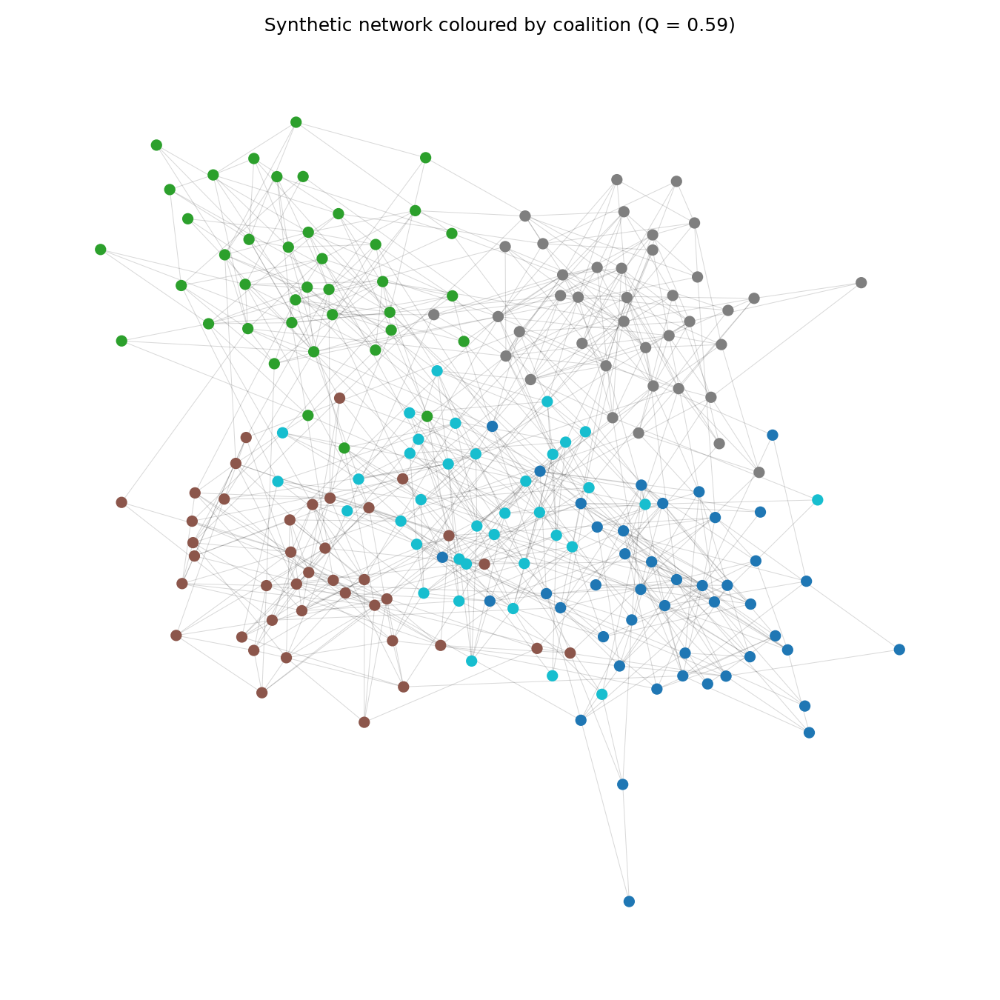
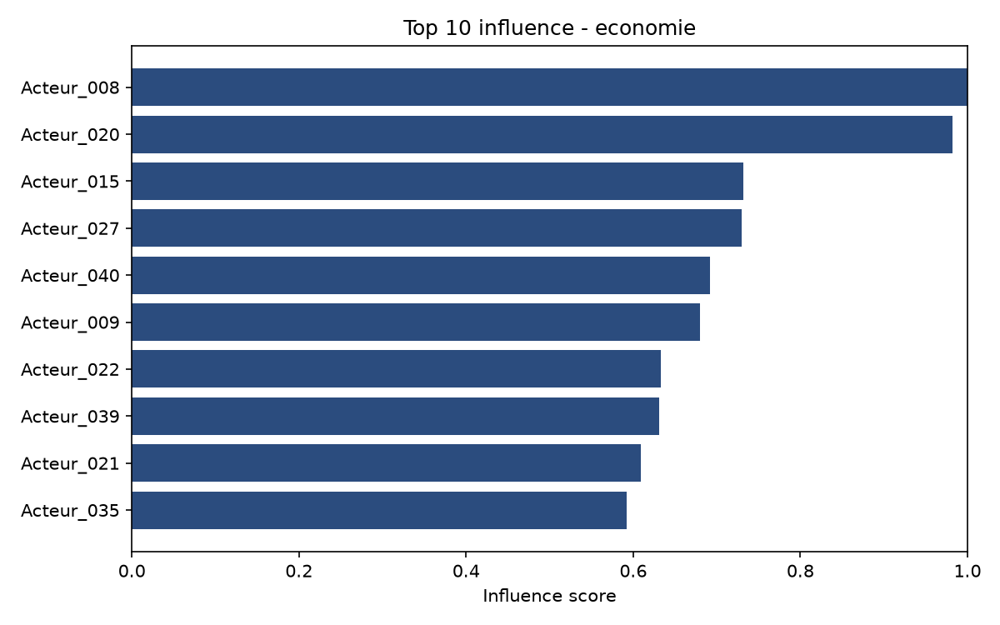

# radar-graph-analytics

Simplified, standalone reimplementation of the graph-analysis core of my bachelor's thesis on diplomatic relationship-network analysis. Uses synthetic data only and contains no code or data from the production system.

## Methods

- **Synthetic network** – undirected stochastic block model (200 actors by default, fixed seed); each tie carries a strength in [0, 1] for five domains (economie, securite, culture, sante, education).
- **Influence score** – per domain, a configurable weighted combination of weighted degree, betweenness (distance = 1 / strength) and eigenvector centralities, each min-max normalised; `top_k(graph, domain, k)`.
- **Introduction path** – Dijkstra with edge cost `1 / (strength + 1e-6)` in the chosen domain; returns the path and its mean tie strength.
- **Coalitions** – Louvain community detection (fixed seed) with modularity score.

## Installation

```bash
python -m venv .venv
source .venv/bin/activate
pip install -r requirements.txt
```

## Usage

```bash
pytest -q
python examples/demo.py
```

```python
from radar import generate_network, top_k, best_introduction_path, detect_coalitions

g = generate_network(n=200, seed=42)
top_k(g, "economie", k=10, weights={"degree": 0.5, "betweenness": 0.25, "eigenvector": 0.25})
best_introduction_path(g, "Acteur_001", "Acteur_150", "economie")
detect_coalitions(g, seed=42)
```

## Figures





## Author

Mickaël Agossa – MIT License, 2026.
